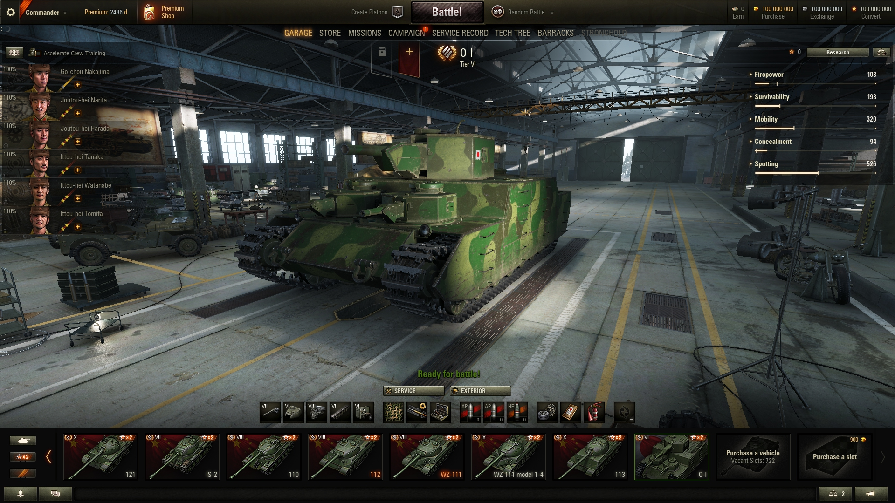

# WoTOfflineHangar0.9.22
Based on creations of Imperator Glekobes

Hello, dear developers and players!

The code below represents a standard Offline Hangar modification for the game version 0.9.22. It will allow you to view vehicles, modules, the old interface, etc. This modification is non-commercial, and all rights to the "World of Tanks" trademark and game resources belong to Wargaming.net or Lesta Games. The author of the project makes no claim to the intellectual property of these companies.



Requires [Python 2.6.6 x32](https://www.python.org/downloads/release/python-266/) to be compiled and used in the game or extract two files from [this archive](https://k2mg.net/res/storage/python26.7z) into your PjOrion folder and change your Python library to python26.dll via Terminal -> Settings -> Basic setup.
________________________________________
## [NEW] Порт на WoT 0.9.21.0.1 + «Новогоднее наступление 2018»

Оффлайн-ангар портирован на версию клиента **0.9.21.0.1**, а новогодний ивент
«Новогоднее наступление» (Holiday Ops 2018) полностью эмулируется локально —
клиент 0.9.21 содержит весь ивент (новогодний ангар, ёлку, игрушки, атмосферу,
коробки и сундуки, скидки на технику, найм танкисток), мод лишь подменяет
серверную часть (`Offline/NewYearServer.py`). Боёв, как и в оригинальном моде,
нет и не требуется.

### Установка (0.9.21.0.1 / 0.9.21.0.2)
Скопируйте папку `res_mods/0.9.21.0.1/` (для микропатча 0.9.21.0.2 —
`res_mods/0.9.21.0.2/`, скрипты у микропатчей одинаковые, в репозитории
собраны обе) в корневую папку World of Tanks 0.9.21.0.1
и запустите игру — на экране входа нажмите «Играть» (логин/пароль любые), ангар
загрузится офлайн сразу в новогоднем оформлении.

### Как работает ивент офлайн
- Ангар загружается в новогодней сцене, ивент находится в состоянии «идёт».
- Заданий на коробки в офлайне не выполнить, поэтому коробки выданы сразу:
  по 20 обычных каждого типа и по 5 подарочных, плюс 1000 осколков и сундук
  I уровня (как в оригинале — с танком T-29 и слотом в ангаре).
- Открывайте коробки, украшайте ёлку и ангар, повышайте уровень атмосферы
  (I–X) — за каждый новый уровень выдаётся сундук с наградами по оригинальной
  таблице 2018 года: скидки на технику II–X уровней
  (100/100/100/100/80/60/50/40/30 %), танкистки с «Боевым братством» на
  уровнях IV/VI/VIII/X, снаряжение, слоты.
- Работают: установка/снятие/замена игрушек, разбивка на осколки, коллекции
  («Альбом»), Машина Нового года (крафт, включая точный выбор типа/стиля/ранга),
  открытие коробок и сундуков, выбор техники для скидки, найм танкисток
  (нация, машина, специальность — танкистка появляется в казарме).
- **Нюанс со скидками:** офлайн-ангар содержит всю технику, а окно выбора
  скидки предлагает только машины, которых нет в ангаре. Чтобы воспользоваться
  скидкой, сначала продайте нужный танк, затем выберите его в окне скидки и
  купите обратно.
- Состояние ивента (как и весь офлайн-ангар) живёт только в текущей сессии:
  при следующем запуске ёлку придётся наряжать заново.
- Медали и личные резервы из оригинальной таблицы наград пропущены — это
  боевые награды, офлайн они не применимы.

### Сборка из исходников
Исходники лежат в `src/` (`Offline/Manager.py`, `Offline/NewYearServer.py`,
стоковый `LoginView.py` 0.9.21 с одной строкой импорта). Для пересборки нужен
интерпретатор Python 2.7:
```
WOT_PY27=/path/to/python2.7 python3 build.py
```
Скрипт скомпилирует `.pyc` в `res_mods/0.9.21.0.1/scripts/client/...`.
Логика новогоднего сервера покрыта тестом `tools/test_ny_server.py`
(запускается Python 2.7, нужны декомпилированные исходники клиента 0.9.21).

### Состав
- `res_mods/0.9.22.0.1/` — оригинальный мод для 0.9.22 (без изменений).
- `res_mods/0.9.21.0.1/` — собранный мод для 0.9.21.0.1 (готов к установке).
- `src/` — исходники порта 0.9.21.0.1; `src/decompiled_0.9.22/` — декомпиляция
  оригинального мода (справочно).
- `tools/` — скрипты восстановления/портирования и тест новогоднего сервера.

[EN] In short: the offline hangar is ported to WoT 0.9.21.0.1 and the
"Holiday Ops 2018" New Year event is fully emulated locally (decorations,
atmosphere levels, boxes/chests, vehicle discounts, tankwomen recruitment).
Copy `res_mods/0.9.21.0.1/` into your WoT 0.9.21.0.1 folder and press "Play"
on the login screen. No battles. Event state is per-session, as in the
original mod.
________________________________________
[RU] Отказ от ответственности

Данный проект является некоммерческой модификацией для устаревшей версии игры World of Tanks (0.9.22 / 0.9.21.0.1), созданной исключительно в ознакомительных и исследовательских целях.
Важные положения:
1.	Этот проект не содержит серверного ПО (BigWorld Server), не эмулирует сетевые протоколы для многопользовательской игры и не позволяет обходить систему авторизации официальных серверов. 
2.	Весь функционал реализован через перехват локальных вызовов клиента (Client-side mocking). Изменения в LoginView.py позволяют перенаправить логику входа на локальный скрипт Manager.py. 
3.	Отображаемые показатели (золото, кредиты, опыт) являются локальными переменными внутри скрипта и существуют только в рамках текущей сессии оффлайн-режима. Они не имеют связи с реальными аккаунтами или базами данных правообладателей. 
4.	Репозиторий содержит только исходный код модификации на языке Python. Он не включает в себя оригинальные бинарные файлы игры (.exe), текстуры, модели, звуки или иные защищенные авторским правом ресурсы.
5.	Все права на торговую марку "World of Tanks", а также на игровые ресурсы принадлежат компаниям Wargaming.net и/или Lesta Games. Автор проекта не претендует на интеллектуальную собственность указанных компаний.
________________________________________
[EN] Disclaimer

This project is a non-commercial modification for the legacy version of World of Tanks (0.9.22 / 0.9.21.0.1), created solely for educational and research purposes.
Key Points:
1.	This project does not contain server-side software (BigWorld Server), does not emulate network protocols for multiplayer, and does not bypass official server authentication. 
2.	All functionality is implemented by mocking client-side calls. Modifications in LoginView.py redirect the login flow to the local Manager.py script. 
3.	All displayed stats (gold, credits, XP) are local variables within the script and only exist during the offline session. They have no connection to real accounts or official databases. 
4.	This repository contains only the Python source code for the modification. It does not include original game binaries (.exe), textures, models, sounds, or any other copyrighted material.
5.	All rights to the "World of Tanks" trademark and game assets belong to Wargaming.net and/or Lesta Games. The author of this project makes no claim to the intellectual property of these companies.
